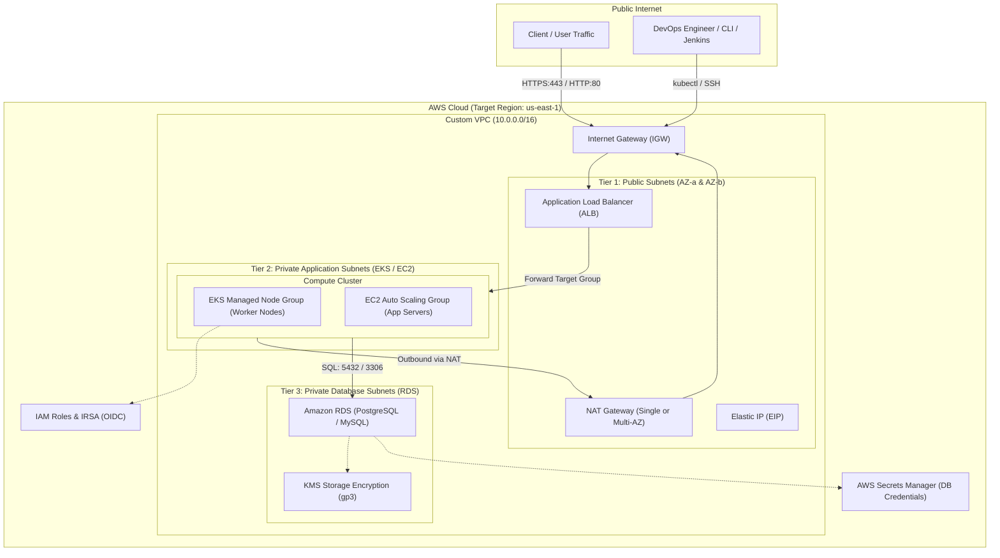

# 🏛️ Cloud Architecture Specification

## 1. Overview & High-Level Topology

`one-click-infra` implements a multi-tier, highly available, secure cloud architecture on Amazon Web Services (AWS) using modular Terraform.

---

## 2. Network Tier Design (VPC)

The network is segregated into three functional isolation zones across two or more Availability Zones:

| Subnet Tier | CIDR Block Mask | Route Table Destination | Public IP? | Primary Workloads |
| :--- | :--- | :--- | :--- | :--- |
| **Public Subnets** | `/20` (e.g. `10.0.0.0/20`, `10.0.16.0/20`) | Default Route `0.0.0.0/0` $\to$ **IGW** | Yes | Internet Gateways, NAT Gateways, Public ALBs |
| **Private App Subnets** | `/20` (e.g. `10.0.64.0/20`, `10.0.80.0/20`) | Default Route `0.0.0.0/0` $\to$ **NAT GW** | No | EKS Managed Node Groups, EC2 Auto Scaling Instances |
| **Private DB Subnets** | `/20` (e.g. `10.0.128.0/20`, `10.0.144.0/20`) | Local VPC Route Only | No | Amazon RDS DB Subnet Group (Isolated) |

### Tagging for Kubernetes Discovery
Subnets include Kubernetes tags required by the AWS Load Balancer Controller:
- Public Subnets: `kubernetes.io/role/elb = 1`
- Private Subnets: `kubernetes.io/role/internal-elb = 1`
- Cluster Association: `kubernetes.io/cluster/<cluster-name> = shared`

---

## 3. Compute Architecture Options

### Option A: Amazon Elastic Kubernetes Service (EKS)
- **Control Plane**: Managed by AWS, replicated across multiple AZs. Configured with dual public/private endpoint access.
- **Worker Nodes**: AWS Managed Node Group deployed into private subnets.
- **Node Auto-scaling**: Configurable minimum, desired, and maximum instance counts.
- **IAM Roles for Service Accounts (IRSA)**: An OpenID Connect (OIDC) identity provider is established automatically to allow pods to assume fine-grained IAM roles without static credentials.

### Option B: EC2 Auto Scaling Group with ALB
- **Launch Template**: Provisions latest Amazon Linux 2023 with gp3 root storage and parameterized bootstrap `user-data` script.
- **Auto Scaling Group**: Spans private subnets with instance refresh policies and automatic ELB health check replacements.
- **Load Balancer**: External Application Load Balancer with dynamic target group health checks on `/`.

---

## 4. Database Architecture (Amazon RDS)

- **Engines Supported**: PostgreSQL (default) or MySQL.
- **Subnet Placement**: Restricted to the dedicated `private-db` subnets.
- **Network Security**: Database security group accepts ingress traffic **only** from the active compute tier security group (EKS node group or EC2 instances).
- **Credentials Lifecycle**: Master credentials are generated randomly using Terraform's `random_password` provider and synced automatically to **AWS Secrets Manager**.
- **Backup & Retention**: 7-day automated backups for `prod`, 1-day for `dev`/`staging`.

---

## 5. Cost Optimization Strategies

| Feature | Development / Staging | Production |
| :--- | :--- | :--- |
| **NAT Gateways** | Single NAT Gateway (`single_nat_gateway = true`) | 1 NAT Gateway per AZ (Redundant) |
| **EKS Nodes** | `t3.medium` (2 nodes) | `m5.large` or `c5.xlarge` (3-6 nodes) |
| **RDS Multi-AZ** | Disabled (`multi_az = false`) | Enabled (`multi_az = true`) |
| **RDS Instance** | `db.t4g.micro` | `db.r6g.large` |
| **Storage Class** | `gp3` (3000 IOPS baseline included) | `gp3` with provisioned throughput |
